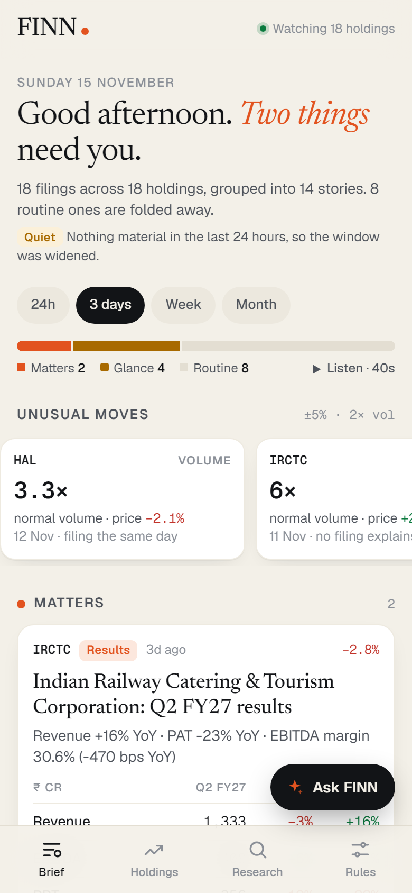
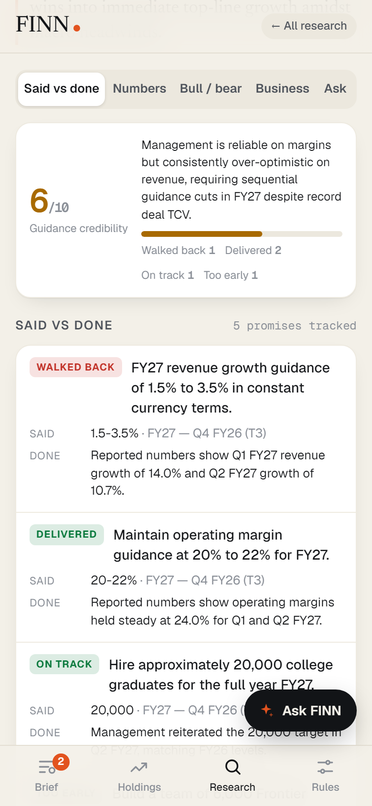
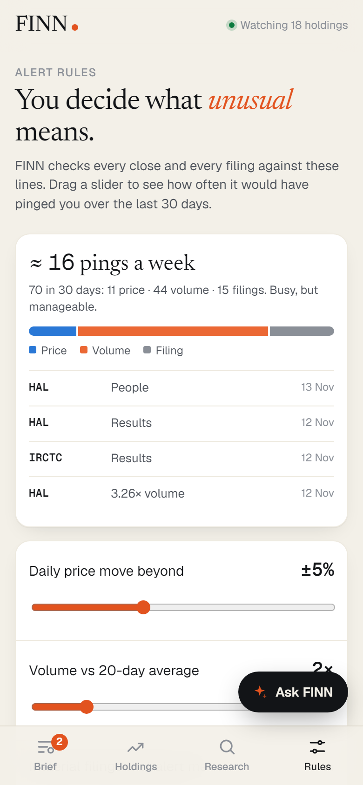
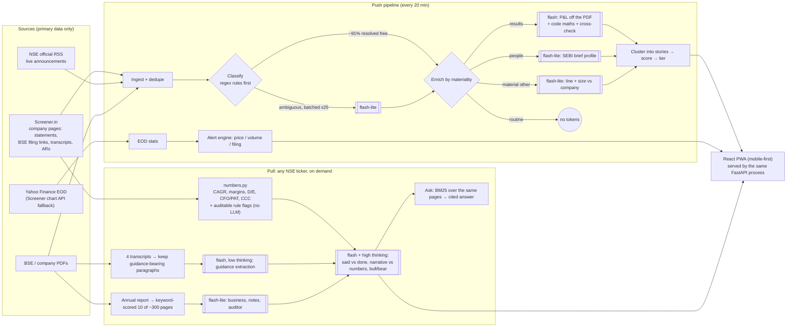

# FINN: Financial Investment Agent

**A mobile-first agent that tells an investor the few things that matter across their portfolio (Push), and checks what management promised against what it delivered (Pull).**

> **Try it on your phone:** **https://finn-ytj8.onrender.com** (add to home screen; it installs as an app)
> Built for the ENAM AI Engineer Build Challenge, Nov 2026.

| Brief (push) | Said vs done (pull) | Rules |
|---|---|---|
|  |  |  |

---

## The point of view

An investor's problem is filtering, not aggregation. So FINN is built as an **editor, not a dashboard**. Every screen answers one question:

| Screen | Question it answers | What makes it different |
|---|---|---|
| **Brief** | *What needs me since I last looked?* | Opens on a sentence ("Two things need you"), not a feed. A funnel shows exactly how much was filtered (33 filings → 30 stories → 3 that matter). Related filings (results + board outcome + deck + newspaper ad) collapse into **one story**. Routine paperwork is folded away and counted, not deleted. Weekends don't produce an empty screen; the window widens and says so. 40-second audio brief via the phone's own TTS. |
| **Holdings** | *Where is something happening in my book?* | Sorted by "needs attention" (materiality × volume anomaly), not alphabetically. One tap opens filings, last 5 quarters and research. |
| **Research** | *Can I trust this management?* | Leads with **Said vs done**, a ledger of every guidance statement from the last four earnings calls, each with a verdict (delivered / on track / behind / missed / walked back), the reported number that decides it, and a link to the exact transcript page. Numbers, bull/bear, business and "ask the filings" sit behind it. |
| **Rules** | *What does "unusual" mean to me?* | Each threshold shows its cost as you drag: "≈ 17 pings a week", backtested on the last 30 days. You choose your noise level knowingly. |

The two examples the brief singled out are handled as first-class cards:

- **Quarterly results →** Revenue / EBITDA / PBT / PAT, QoQ and YoY, read **from the results filing itself**. Arithmetic is done in code, never by the model. Each extraction is **cross-checked** against exchange-standardised figures and badged ✓ (or ⚠ if they disagree). Scanned PDFs go to vision; text PDFs send only the 4 relevant pages. Lenders get pre-provision operating profit, because EBITDA is meaningless for a bank.
- **Management change →** who the person is, from the **"brief profile" that SEBI LODR requires in every appointment filing**: prior roles, education, experience, plus a LinkedIn search link. That is primary-sourced, free and always present. The model also judges whether it's a *top* change (CEO/MD/CFO/Chair joining or leaving) versus a re-appointment or an additional-charge handover, which changes its priority.

Everything else gets the treatment it earns: order wins, penalties and deals get one line **plus their size relative to the company** ("₹909 Cr = 3.0% of TTM revenue"). Rating reaffirmations sink. Newspaper ads and ESOP allotments never cost a token.

---

## Architecture



One container: FastAPI serves the API and the built PWA, and a background thread refreshes the feeds (every 20 minutes while companies file, hourly otherwise). State is JSON on disk (a content-addressed cache), which is enough for one investor and keeps the deployment to a single `docker run`. It is hosted on Render's free tier from `render.yaml`. Free instances sleep after 15 idle minutes, so the app pings its own public URL every 10 minutes (`FINN_KEEPALIVE=1`) to avoid a cold start of about a minute for whoever opens it next.

### Model routing: the expensive model only where reasoning changes the answer

| Step | Who does it | Why |
|---|---|---|
| Classify 90 filings | **Regex rules** (82) → flash-lite, batched (8) | Exchange subjects are semi-structured. Rules are free and auditable. |
| Results headline numbers | **Flash** (vision if scanned) + **code** for EBITDA, QoQ, YoY | Numbers must be right; arithmetic is never delegated to a model. Verified against a second source. |
| Bios, one-liners, sizing | **Flash-lite** | Short extraction from short documents. |
| Transcript extraction (guidance, targets, quotes) | **Flash, low thinking** on **pre-filtered text** | The "said" half of the ledger must be exact. I tested Flash-Lite here: it mislabelled a call's quarter and missed guidance restatements, so this step earns Flash. Operator and disclaimer noise is stripped first. |
| Annual-report extraction | **Flash-Lite** on **10 of ~300 pages** | Keyword-scored page retrieval picks the business, segment, contingent-liability, related-party and auditor pages. Lite is enough for this. |
| Promise vs delivery judgement | **Flash + high thinking**, 1 call per company | The only step that needs multi-document reasoning. |
| Ratios, growth, cash conversion, red flags | **Plain Python** | Deterministic, testable, free. |

- **Caching:** every model call is content-addressed on disk (prompt + document hash). Filings never change, so a filing is read once, ever. The repo ships the cache, so a reviewer's first open costs **zero calls**.
- **No request ever waits on a data source.** Source data (Screener statements, EOD prices) is served *stale-while-revalidate*: a page gets the last good copy at once and the refresh happens in the background, once per key (concurrent requests collapse into one fetch), with a 10-minute back-off if a source is failing. Parsed JSON is held in memory keyed on file mtime, because parsing was 60-75% of request time.
- **Polling matches when companies actually file.** NSE's official RSS (one request covers every company) is checked every cycle. Screener's per-company lists are only a backfill: every 2 h on weekdays 08:00-23:00 IST, every 6 h otherwise, and the cycle itself slows from 20 to 60 minutes at night and on weekends. This makes about 320 requests on a weekday, against about 1,480 before.
- **Follow-up questions don't re-read documents.** Each company gets a BM25 index (about 500 pages of transcripts plus the annual report) built once and kept in memory, with stopwords dropped so "what did management say about…" doesn't outweigh the actual subject.

**Measured speed-ups** (local, same data; a 0.1-CPU free host stretches the "before" column about 10×):

| | Before | After |
|---|---|---|
| Open Brief when cached prices are stale (e.g. right after a deploy) | 16 s (waited on Yahoo) | 0.04 s |
| Open Holdings when company data is stale | ~27 s (18 polite Screener fetches) | 0.12 s |
| Follow-up question, retrieval step | 150-340 ms | 1.5 ms after the first question (query-term coverage of the cited pages equal or better on 8 test questions) |
| Background refresh cycle when nothing is new | 26 s | 0.2 s (RSS only) |

The PWA works offline: the app shell and fingerprinted assets are cached, and the last brief, holdings and finished dossiers open without a network. Data requests always try the network first.
- **Quota-aware model pools:** Gemini's free tier has *per-model* daily quotas (Flash is about 20 requests a day). Each tier is a pool of interchangeable models (`gemini-3.5-flash` → `gemini-3-flash-preview` → `gemini-flash-latest`). When one model's daily quota is exhausted FINN moves along the pool, and only when the pool is dry does it degrade a tier, so the app never just fails. Fallback models get *low* thinking: at high thinking one of them spent 64k tokens and 3 minutes on a judgement the primary makes in 8k.

**Measured cost** (this build, Gemini free tier):

| | Calls | Tokens | Paid-tier equivalent |
|---|---|---|---|
| Push: classify + enrich 90 filings across 18 stocks | 34 (3 batched triage, 2 results, 12 people, 17 one-liners) | 74k | ≈ $0.01 |
| Pull: one research dossier (4 transcripts + AR + judgement) | 6 | 45–85k | ≈ $0.02–0.03 |
| Re-opening anything already read | 0 | 0 | $0 |

Actual spend: **₹0**. Every dossier shows its own cost and which models made it ("How this was made").

---

## Grounding discipline (Pull side)

- Inputs are only **exchange-reported financials, the company's own concall transcripts, and its annual report**. No news, broker notes or Screener's AI summaries, and the prompt forbids outside knowledge.
- Every claim carries a source tag (`T2 p.5`, `AR p.345`) that **opens the PDF at that page**.
- The model **reads**; code **counts**. Growth rates, margins and YoY figures are computed in `numbers.py` and handed to the model as facts.
- **Screener's concall labels are sometimes wrong** (a "Jul 2026" entry links to a July 2025 transcript). FINN takes the period from the transcript text, not the label.
- Companies that publish no transcripts (e.g. Trent) fall back to investor presentations, and the dossier says so.

---

## What I deliberately left out

- **NSE/BSE private JSON APIs.** Full announcement history lives behind cookie/referer-gated endpoints meant for browsers. I used NSE's **official RSS** plus Screener's per-company filing list instead. The trade-off is ~5 recent filings per company on cold start, with history accumulating from then on. In production this should be a licensed exchange feed.
- **Scraping LinkedIn** (against its terms of service, and brittle). The SEBI-mandated profile in the filing is better primary data, and a LinkedIn *search link* covers the rest.
- **Accounts, multi-portfolio, a database, background push via APNs/FCM.** Notifications work while the PWA is open or installed (service worker + Notification API). Real server push is the next step.
- **Embeddings / vector DB.** BM25 over pre-selected pages is enough for a single company's documents, and costs nothing.
- **Intraday data.** The brief is EOD. Alerts run on closes.

## Where I'd take it next

1. **Guidance memory across quarters.** Persist every extracted promise as a row, so the ledger becomes a running credibility score per management team, and the Push side can alert "*management just cut guidance for the second time*".
2. **Portfolio-aware materiality.** Learn from what the investor opens, mutes and researches; today the "hide" button is the only teacher.
3. **Real push** (Web Push with VAPID) and a morning digest at 8:30 IST.
4. **Peer context in results cards.** "Revenue +16% YoY vs sector median +9%".
5. **Licensed filing feed**, and XBRL parsing for results (exact numbers, no model needed at all).

---

## Run it locally

```bash
python -m venv .venv && .venv/Scripts/activate      # or source .venv/bin/activate
pip install -r requirements.txt
echo GEMINI_API_KEY=your_key > .env                 # free key: aistudio.google.com/apikey
cd frontend && npm install && npm run build && cd ..
uvicorn backend.app:app --port 7860                 # open http://localhost:7860
```

Without a key FINN still runs in numbers-only mode: digest, alerts, financial analysis and rule flags all work, and model-written parts are skipped.

Docker: `docker build -t finn . && docker run -p 7860:7860 -e GEMINI_API_KEY=... finn`

Deploy your own: [one click on Render](https://render.com/deploy?repo=https://github.com/0123Saksham/finn) (free plan; it asks for `GEMINI_API_KEY`).

Config lives in `backend/config.py`: the portfolio (18 NSE names from ₹18 lakh Cr Reliance down to ₹15k Cr KPIT, banks to defence to renewables), default alert rules, and the model pools (`FINN_MODEL_DEEP=gemini-3.1-pro-preview` upgrades only the judgement step on a paid key).

### Repo map

```
backend/
  app.py              FastAPI routes + scheduler + static PWA
  llm.py              tiered routing, model pools, cache, cost meter
  sources/            screener.py · nse_rss.py · prices.py · filings.py (PDF text, page retrieval)
  push/               classify.py (rules → LLM) · enrich.py (results / people / sizing) · feed.py (store, clusters, scoring, alerts)
  pull/               numbers.py (deterministic analysis) · research.py (agent pipeline, judge, ask)
frontend/src/         Brief · Story · Holdings · Research · Rules · ui (charts, sheet)
data/cache/           committed cache: filings store, extractions, dossiers
```
